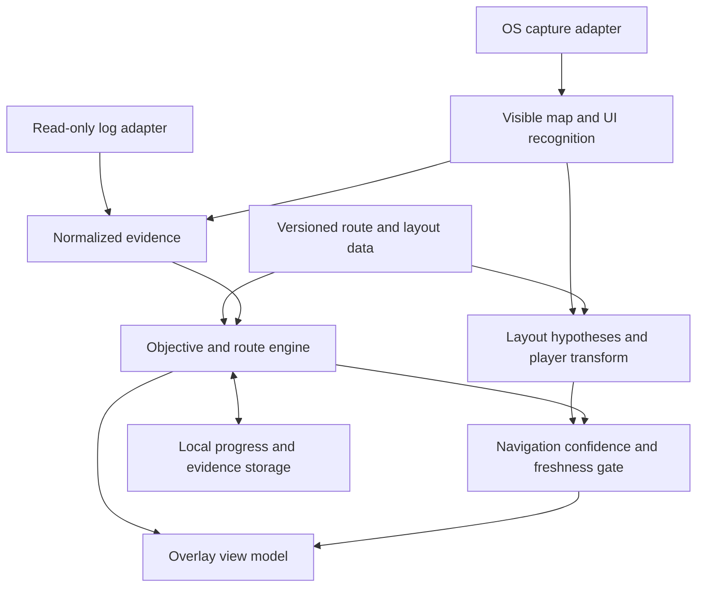

# Architecture proposal

Phase 1.3, researched 2026-11-11. This is a design, not a tested implementation.
Requirements: [scope](scope.md). Decisions: [decision log](decisions.md).

Reference implementation review: [Qutm](qutm-review.md) supplies concrete candidate
zone, level-up and dialogue/reward patterns. Prioritize validating those log inputs
for the checklist before adding OCR. Its manually selected layout diagrams do not
resolve our automatic positioning requirement. An [initial local inspection](log-findings.md)
confirms area ID/level/seed, level-up and passive-point rewards in a September 2026
sample. A full-file follow-up also finds instance IDs, tile/doodad hashes and
height-map texture dimensions, but no usable player-position or map-geometry
feed. Quest dialogue indicates some stages, not generic item acquisition.
The step-4 questions below still require labelled/current-patch validation.

The owner accepted this log-first direction and explicitly excluded inventory
scanning. No inventory scan, scan replay or price-check subsystem is planned.
Quest-item objectives remain part of the evidence-based progress engine.

## Recommended structure

Start with Tauri 2, a Rust application core and a TypeScript web UI. Treat this
as a candidate until the Windows/Hyprland overlay spike passes. Keep platform
capture and window handling behind interfaces so the core survives a shell change.
Use one desktop application with background workers; no server, account or cloud
vision service is needed. Proposed source boundaries:

| Part | Responsibility |
| --- | --- |
| `core/domain` | Character sessions, objective state, route selection and evidence rules |
| `core/logs` | Read-only log tailing, rotation/truncation recovery, versioned parsers |
| `core/capture` | Windows and Linux capture adapters, bounded latest-frame queue |
| `core/vision` | Map/UI regions, player marker, geometry and visible objective recognition |
| `core/matching` | Rank layout hypotheses, estimate transforms and uncertainty |
| `core/navigation` | Choose next objective and produce expiring directional guidance |
| `core/storage` | Local SQLite progress, evidence history and settings |
| `ui` | Checklist, layout panel, arrow and separate interactive settings window |
| `data` | Versioned route, zone and layout JSON plus licensed assets |
| `fixtures` | Offline samples with provenance and expected observations |

These are proposed boundaries, not files already created. Start with simple
TypeScript/CSS UI; a UI framework is not required to validate the overlay.

## Data flow

The basis for informed, read-only log access is recorded from GGG's developer
policy in map-reading.md. Live capture/visual inference remains gated pending a
permitted basis for the exact behavior. Offline replay uses the same evidence pipeline.
The renderer receives compact view models, not a stream of raw frames. Rust owns
file access, persistence and workers; expose only narrow UI commands and events.

## Evidence and progress

Every observation carries source, timestamp, session/zone generation, parser or
recognizer version and confidence. Character identity must be established before
writing progress; allow one-time profile selection if permitted inputs cannot
identify it. Never assign observations to the last-used character by assumption.

Keep objective states `unknown`, `pending` and `complete`, with supporting evidence
and reversible manual overrides. Route order determines what is suggested, not
what is completed. Item seen, item acquired, item consumed, quest completed and
reward claimed are different facts; each objective defines the evidence it needs.
Repeated frames must not double-apply an event. A detected zone transition resets
navigation hypotheses but does not complete all objectives in the old zone.

SQLite transactions store state and its evidence together. Key progress by local
profile, character and campaign/league context; retain route version for migrations.
Treat reset instances separately from character progress, even when zone names
match. Do not assume a seed or unique instance ID exists in the log.

## Map matching and arrow

1. Detect whether an appropriate map is visible; locate the actual player marker
   and map viewport. Handle minimap and expanded map separately.
2. Normalize scale/UI placement and extract explored line geometry and landmarks.
   Start with conventional image processing; choose an OCR/model dependency only
   if the offline experiment demonstrates a need and its licence is suitable.
3. Compare against multiple zone-specific layout hypotheses, allowing translation,
   scale and only the rotations/reflections validated by data. Keep alternatives
   when a short explored corridor fits multiple layouts.
4. Select the next mandatory objective, or a selected optional detour. Require
   evidence for its location. A static template is not an exact map of a newly
   generated instance; predicted targets must be identified as estimates.
5. Prefer a next traversable waypoint on observed geometry when available. An
   initial bearing to an estimated target is not obstacle-aware pathfinding.
6. Publish a direction only when player detection, target location, best-match
   separation and observation freshness pass thresholds calibrated on held-out
   samples. Hide it on mismatch, map closure, capture loss, zone change or expiry.

The app never opens the game map or presses game keys. If the game does not expose
enough visible information, continuous navigation is unavailable in that state.
Geometry matching cannot reveal the true unexplored instance or guarantee the
position of an unseen quest item. Do not manufacture a precise direction from
zone name alone. Measure usable coverage as well as accuracy to avoid a system
that reports high accuracy only by hiding almost all guidance.

The [offline map experiment](map-reading.md) has a synthetic fixed-scale matcher,
but its initial segmentation fails on actual historical minimap crops. It is
research code, not an enabled runtime vision module.

## Platform approach

| Platform | Capture candidate | Overlay candidate / limits |
| --- | --- | --- |
| Windows | Windows.Graphics.Capture, game window selected through system picker | Tauri transparent, undecorated, topmost window; verify click-through and borderless game mode |
| Linux Wayland / Hyprland | XDG ScreenCast portal and PipeWire, using the available backend | Test native window placement and stacking; compositor support/rules may be required |
| Linux X11 / XWayland | Select adapter based on the actual session and available capture support | Test separately; XWayland is an experiment, not a guaranteed Wayland fix |

Official OS capture can require initial permission/source selection and sometimes
renewal. This is compatible with no repeated manual screenshots, but zero-click
capture startup cannot be promised. Respect denied/revoked access and session
closure. Prefer window capture; if only monitor capture works, prevent overlay
self-capture and reject unrelated regions. Process in memory; frame export is
an explicit local debugging action, disabled by default.

Tauri documents topmost and cursor-ignore APIs, but API availability does not prove
stacking over this game on Hyprland. Electron documents Wayland positioning and
stacking limitations too. If both shells fail, evaluate a compositor-specific
presentation adapter before revisiting supported modes with the contributors.
Do not inject rendering into the game to solve overlay problems.

## Performance and failure behavior

Proposed starting budget: sample recognition at 2-5 frames/second, keep only the
latest pending frame, and discard stale results. These are tunable experiment
settings, not measured performance claims. Stop capture when the source closes;
pause recognition when no useful map/UI is visible. UI remains responsive on
worker failure and shows tracking unavailable rather than frozen guidance.

Version route/layout assets by game patch and provenance. Unknown or incompatible
zones disable matching. On startup reconcile stored progress through explicit
migrations; do not silently reset it. No gameplay frame or log upload by default.

## Open questions mapped to Phase 2

| Plan step | Question and experiment | Required record / exit condition |
| --- | --- | --- |
| 4: logs | What does PoE 2 Client.txt expose on zone entry, instance reset, character switch, quest/item actions? Replay samples including rotation/truncation. | Historical fields are documented in log-findings.md; labelled item/quest and current-patch checks remain. |
| 5: overlay | Can Tauri stay above the game without stealing input on Windows and Hyprland? Test borderless/fullscreen, scaling, monitors, focus and click-through; try Electron on a demonstrated failure. | OS/compositor/game modes, toolkit versions, results and reproducible limitations; then choose toolkit in step 8. |
| 6: data | Which PoE 2 routes, objectives, layout variants and landmarks are accurate and reusable? Are layouts templates or exact variants? | Source choices and terms recorded in data-sources.md; current-patch review, adaptation and actual schematic coverage remain. |
| 7: recognition | Is each automatic input and inferred guidance permitted? Can capture, player detection, map matching and completion evidence work without routine manual input? | Document permitted basis and unresolved GGG questions; offline labelled corpus, independent runs held out, false completion rate, direction error, abstention/coverage, latency and both OS results. |

For step 7 include map hidden/open, zoom/pan, multiple similar layouts, fog of war,
new instances, missing quest items, different resolutions, UI scales and languages.
Define acceptance thresholds before evaluating held-out data. Block live automatic
features while their compliance basis is unresolved. Prepare a concrete description
for GGG clarification; sending it is a separate authorized action, not done here.

## Research references

Official documentation checked 2026-11-11; these support API candidates, not claims
that the app works or has GGG approval:

- [Tauri window API](https://v2.tauri.app/reference/javascript/api/namespacewindow/): topmost and cursor-event controls.
- [Windows screen capture](https://learn.microsoft.com/en-us/windows/apps/develop/media-authoring-processing/screen-capture): frames, system picker and device/resize handling.
- [XDG ScreenCast](https://flatpak.github.io/xdg-desktop-portal/docs/doc-org.freedesktop.portal.ScreenCast.html): portal sessions, source selection, PipeWire and restore tokens.
- [Electron BrowserWindow](https://www.electronjs.org/docs/latest/api/browser-window): Wayland restrictions and mouse-event handling.
- [Hyprland window rules](https://wiki.hypr.land/configuring/core/rules/window-rules/): compositor-managed rules; pinning is not proof of fullscreen stacking.
- [GGG Terms of Use](https://www.pathofexile.com/legal/terms-of-use-and-privacy-policy): clauses 7-8; gameplay recording permission does not establish approval of automated analysis.
